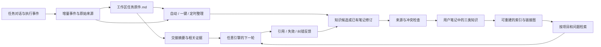

# Duo 知识重构：任务原件与长期笔记

状态：2026-10-30。本文件包含本轮已经落地的代码、已完成的本地整理，以及后续架构方案；不表示所有方案已经实现。代码落地也不代表当前运行服务已升级或知识路径已自动切换。

## v0.34.65 可读性复查与调整

复查发现，上次本地整理主要做文件分类与相同正文去重，大量不足 400 字符的短结论仍独立成篇；旧任务档案主要列逐轮外链，缺少结果、决策与失败信息的展开。新结构保留两层基础，不再增加存储层：

- **任务资料**：工作区主文档显示当前结构化状态，按时间展开原始需求、助手结果、最近执行事件、错误与来源。缺少有效状态时保留真实资料，不根据首轮问候推断目标。旧稀疏条目只做一次追加补全，人工内容保持原样。
- **长期知识**：原笔记作为可编辑、有身份和修订的内容；项目/主题阅读手册作为其派生阅读视图，合编已有正文、条件与依据，分页并提供原笔记入口。浏览三类知识时优先显示手册；它不创建新事实，不自动改变确认状态。
- **检索与提取**：项目知识先限制适用范围，过滤 AI、架构等通用词引发的跨项目误召回；明确点名其他项目仍可检索。后续提取按同一问题成文、稳定主题更新，资料不足就标明缺口，不凑字数。
- **本地重整**：离线默认 `readable` 布局生成任务档案、分页月日志、主题阅读手册；同任务 ID 改名不拆分，同名不同 ID 不强行合并。知识原文及来源哈希保留，知识可直接跳到对应轮次结果。该输出为普通阅读笔记，不自动提升为 `curated`；`--layout source-notes` 才是旧逐条兼容模式。

这是阅读组织和来源追溯的调整，不是对旧结论的语义复验。未来自动语义合并、稳定项目身份配置、执行中 checkpoint 和保留身份的正式数据迁移仍需分别实现与验证。下面标明的 v0.34.64 本地报告属于上一轮，不能当作 v0.34.65 新目录的验收数字。

## 目标与边界

用户需要的基础是两层，而不是继续增加知识入口：

1. **任务原件**：每个任务一篇在工作区内持续更新的 Markdown。维护目标、计划、进展、决策和证据，支持不同任务参考、引擎交接、知识提取。
2. **长期知识**：从任务原件与对话证据中提炼平台共识、系统知识、项目知识，写入用户选定的笔记根，供人阅读学习，也供后续任务检索使用。

原始对话是可追溯资料，数据库保存运行状态、正文快照与搜索索引；人阅读和编辑的入口是 Markdown。不存在“每个问题自动新建一篇知识”的规则。

## 本次落地与后续方案

以下矩阵以本轮工作区实际实现为准；后文的数据流、可见目录和完整自动化协议属于目标设计，不能反向理解为全部已经可用。

| 能力 | 本次实际落地 | 仍属后续方案或明确限制 | 主要代码依据 |
| --- | --- | --- | --- |
| 任务记录与当前位置 | 继续使用工作区内 `.duo/tasks/<任务名-短ID>/任务记录.md`；真实 Markdown 可读写，文首受管区显示当前状态，下方保留时间来源记录 | 尚未迁移到本文件建议的 `<workspace>/任务记录/` 可见目录，短 ID 也仍随目录名保留 | `workspace_memory.go`、`workspace_worklog.go` |
| 当前目标、计划与证据 | 每轮结束后消费已保存的结构化 `task_state`，合并目标、验收、计划状态、进展、决策、证据、阻塞和下一步；完成计划和验证项要求逐字回复依据 | 不是执行中实时 checkpoint；模型未提供合法增量时不捏造状态，也不能保证每轮都有新的目标和计划 | `task_state.go`、`workspace_memory.go` |
| 人工编辑保护 | 受管状态区带内容哈希；人工改动后不会静默覆盖；受管区之外的备注保留 | 不是任意 Markdown 的智能三方合并器；冲突仍需用户处理 | `workspace_worklog.go`、`workspace_memory_io.py` |
| 引擎交接 | 新原生会话可读取当前任务 Markdown 的有界摘录，保留开头状态与最近进展 | 不是每轮向原生会话推送 revision 增量，也未以本轮真实模型测试证明任意引擎完全无缝接替 | `workspace_worklog_context.go` |
| 工作区任务互相参考 | 工作区资料索引提供任务记录入口，可按路径继续查阅 | 不会把所有兄弟任务全文自动注入每个任务；跨引擎、跨设备访问仍取决于执行环境实际路径和权限 | `workspace_memory.go` |
| 三类笔记与路径 | 支持平台共识、系统知识、项目知识；可读目录、中文主题文件、分类首页和原 Markdown 编辑；空分类保留首页 | 用户外部资料不会仅因改目录设置就自动完成语义分类；根路径切换仍需明确配置 | `knowledge_layout.go`、`knowledge_folders.go`、`vault.go` |
| 正文与数据库 | Markdown 可编辑；数据库仍保存 `curated_knowledge.document` 等正文快照，并参与同步、版本及冲突判断 | 尚未成为“数据库只存索引、不存正文”的纯文件原件架构；后文相关表述是演进目标 | `knowledge_layers.go`、`library.go`、`vault.go` |
| 自动、一键、定时整理 | 例行自动/一键/定时处理已经记录的结构化候选；定时器持久化尝试时间及错误，失败不会每次空闲扫描都重试；这些例行整理不另行调用模型 | 不会靠定时器重新理解全部旧聊天。独立的“AI 提取”动作需要用户明确触发和确认，才向当前支持引擎提交真实整理请求，不是例行整理的隐含步骤 | `knowledge_extract.go`、`knowledge_schedule.go`、`knowledge_extraction_job.go` |
| 同主题修订 | 同层级、作用域、标题的候选可进入既有笔记的待合并修订，保留来源和基线哈希；本机采用/忽略需版本检查 | 不自动覆盖既有正文；跨设备同时变更的 `pending_revisions` 不做自动合并，冲突保留并要求处理 | `knowledge_revision.go`、`knowledge_layers.go` |
| 知识检索 | 本轮问题与标题、主题/项目、标签和正文进行关键词匹配；最多返回 4 篇有界摘录，显示状态、版本、依据和适用条件，跳过失效内容 | 是关键词检索，不是向量、语义搜索或 GraphRAG；候选命中也不是本轮验证证据 | `knowledge_recall.go` |
| 本地旧资料整理 | `readable` 输出每任务档案、分页月日志和主题手册，原件及 SHA-256 保留；本轮另选读 7 份原始回复形成一篇待核对导读 | 是独立阅读视图，不创建正式知识身份或接管数据库；旧 `source-notes` 模式会重建身份，不能直接切根充当迁移。尚未完成全部旧对话语义重整或实验复验 | `scripts/Organize-KnowledgeVault.py`、目标目录 `迁移清单.json` |

“最近定时整理”只表示定时器处理候选的结果，不代表 Markdown 已写入笔记目录；文件同步是否成功、是否有冲突，需独立查看知识库的文件同步状态。

这次落地先解决可读任务状态、候选整理与本地资料组织。执行中 checkpoint、完整增量交接、纯文件主数据、跨设备待合并修订协调和语义检索应分别验收，不能混同为已经完成。

## 参考方案与取舍

以下是本轮读取公开正文的参考，不是流行度排名。没有一种方案可以直接满足本需求，采用其可用机制，不强行复制其全部目录。

| 来源 | 经核对的机制 | Duo 采用方式 | 不直接复制的部分 |
| --- | --- | --- | --- |
| [PARA / Forte Labs](https://fortelabs.com/blog/para/) | Projects 为有结果目标的项目；Areas 为持续责任；Resources 为主题资料；Archives 为非活跃资料 | 活跃项目有项目首页，完成任务进入归档状态；主题知识与项目过程分开 | 不以四个英文目录替换用户已经定义的三类知识；任务完成不等于知识失效 |
| [Obsidian Properties](https://help.obsidian.md/properties) | 属性保存文本、链接、日期、列表、标签等结构信息，支持属性搜索 | YAML 中保存 ID、项目、状态、来源、标签；普通 Markdown 仍能阅读 | 不把正文全部变成属性；不依赖特定社区插件才能使用 |
| [Obsidian Backlinks](https://help.obsidian.md/plugins/backlinks) | 反向链接来自笔记间实际链接，并可区分已链接、未链接提及 | 知识链接任务证据；知识之间建立明确相关关系；标签用于筛选和导航 | 关系图谱本身不是事实验证，也不能用堆标签替代有语义的链接 |
| [Zettelkasten introduction](https://zettelkasten.de/introduction/) | 关注思想之间的连接；原子性帮助单篇解释一个可复用问题；来源与结构笔记辅助理解 | 一篇解决一个明确主题，带来源、适用条件、相关笔记；主题首页做结构入口 | 不把完整任务日志拆成碎片卡片；不为每条聊天生成原子笔记 |
| [Microsoft RAG](https://learn.microsoft.com/en-us/azure/search/retrieval-augmented-generation-overview) | 先检索相关资料，再作为生成上下文；全文、向量和混合检索服务于相关性 | 首期使用标题、标签、项目、全文搜索；只读取命中的段落和证据 | 不先建大向量库再补资料质量；检索命中不等于事实成立 |
| [Microsoft GraphRAG](https://microsoft.github.io/graphrag/) / [Indexing](https://microsoft.github.io/graphrag/index/overview/) | 索引流水线从文本提取实体和关系、形成社区与摘要，支持不同层次查询 | 先使用确定性来源、项目、标签、显式链接图；后续按实际跨文档问题评估 GraphRAG | 不在第一期对所有聊天调用模型抽实体；额外成本和错误传播必须评估 |
| [AHA2 固定提交](https://github.com/ChinaKai/AHA2/tree/f753cc57c9f621c4f7342526895bce9b43c416d5) | 项目/工作区/任务分离；知识分层索引；候选与修订；逐级读索引后读取正文 | 稳定项目身份、候选修订、来源任务/轮次、按需读取、失败回到修订队列 | AHA2 主数据为数据库，Markdown 是上下文快照；不能替代用户直接编辑同一笔记原件的要求 |

AHA2 当前任务记忆主要维护当前目标和目标变更事件，并非完整的任务日志维护器。其 AHA1 导入还默认排除 `task_worklog`。所以任务原件要根据用户目标独立设计，不能宣称复制 AHA2 后就具备了完整目标、计划、进展、决策和证据更新。

## 总体数据流



目标架构中，Markdown 正文是用户可编辑的内容原件，数据库逐步收敛到 ID、原件路径、修订号、队列、来源关系、内容哈希和可重建索引。**当前实现仍保存正文快照**，不能据此文档删除现有数据库或宣布完成纯文件迁移。无论采用哪个存储阶段，都不能静默覆盖用户 Markdown 或独立维护两套目标计划。

## 第一层：任务原件

后续建议路径；本轮实际路径仍是 `.duo/tasks/<任务名-短ID>/任务记录.md`，未进行下述目录迁移：

```text
<workspace>/任务记录/
  首页.md
  375平台64MDDR验证/
    任务记录.md
    证据/                    # 只保存必要、允许保留的日志或截图
```

任务 ID 放在属性中；目录优先显示用户输入的任务名。同名任务才追加短 ID。任务改名可以保持既有目录并修改标题和 alias，或显式迁移并重写引用；不能因一次改名失去上下文。新建任务应要求或建议简短任务名，不能把“你好”作为永久任务目标。

任务原件结构：

```markdown
---
id: task-stable-id
title: 375平台64MDDR验证
type: task
project: 375平台
status: active
revision: 12
tags: [375平台, DDR, 验证]
---

# 375平台64MDDR验证

## 当前目标与验收标准
## 当前计划
## 当前进展与结论
## 已确认决策及原因
## 证据与验证
## 阻塞、未解决问题与下一步
## 按时间记录
```

顶部是当前事实状态，下方是关键变化的时间线。时间线记录“发生了什么、为何改变、证据在哪里”，不重复转录全部聊天。

### 目标更新策略与本轮边界

- 每个完成的轮次检查是否产生变化。有有效新目标、计划变更、进展、决策、证据或阻塞时才写入。
- 后续长任务应在关键里程碑保存进度，防止只有最后成功时才有记忆；**本轮实现仍在每轮结束时落盘，没有执行中 checkpoint**。
- 失败、停止和取消也写已实际完成的事实及剩余问题；不能把未执行计划标为完成。
- 问候和纯授权答复保存在原始对话，不生成空泛任务进展。
- 写入事件带 `task_id + run_id + event_id`，重复回调不会重复追加。

### 更新协议目标

引擎提交结构化增量：目标变更、计划状态、事实进展、决策与原因、证据引用、未决问题、下一步。不要求每轮重新生成整份任务文档。Duo 校验来源和版本后，以受管区段或明确字段补丁更新；用户自行写的段落不被模型整篇重写。

读取文件时记录内容哈希，保存用 compare-and-swap。冲突时重读并生成合并建议，不静默覆盖。原始来源先持久化，再提交 Markdown 补丁；落盘失败进可重试队列，任务回答不丢失。无有效增量不调用额外整理模型。

### 引擎切换与同工作区共享

每轮提示词包含任务原件路径、当前状态的有界摘要、上次消费的 revision，以及需要读取的证据入口。新建或切换会话先读取当前原件，按需展开历史。保持同一原生会话时只注入发生变化的摘要和版本，不每轮复制整个历史。

工作区 `首页.md` 只列任务名、项目、状态、摘要、更新时间、相对链接。同工作区其他任务可按需引用该索引，再读取有关任务。只在与当前问题相关、且在该执行环境可访问的范围共享；不要把全部兄弟任务正文常驻提示词。Windows、WSL、SSH 的路径映射由执行适配器处理，不能向 Linux 模型只给一个不可访问的 Windows 路径。

## 第二层：长期知识

```text
<选定笔记根>/
  首页.md
  平台共识/
    调试与协作约定.md
  系统知识/
    Linux/
      NFS原理与排查.md
  项目知识/
    375平台/
      首页.md
      调试与验证/
        64M DDR验证结论.md
      资料/
```

选定的路径就是实际根目录，不隐式再追加 `Duo/`。三个目录可分别映射到用户现有目录，但映射关系必须在预览中明确显示；配置改变不能只换写入路径而留下错误首页链接。

平台共识仅包含用户明确认可的跨任务规则。系统知识解释可迁移的原理与方法；项目知识保留具体硬件、版本、条件、设计决策和验证结果。自动分类可以提议移动与关联，不能因标签中出现 Linux 就把某型号的实验结论当作通用系统规律。

属性建议：`id`、`title`、`layer`、`project`、`status`、`tags`、`aliases`、`source_tasks`、`source_events`、`content_hash`、`updated`、`reviewed`。正文包含问题、结论/办法、依据、实际验证结果、适用条件、未解决事项与相关笔记。ID 和日期是属性，默认文件名是可读的中文主题；同主题更新既有原件，不每轮新建。

### 自动、一键、定时整理的演进目标

本轮例行入口只整理已保存候选，不发起额外模型请求；下面第 1—3 步的完整自动语义提炼是后续服务目标。单独的“AI 提取”是明确触发并确认后的真实模型任务，不能和免费、离线的候选归档混为一谈。

三个入口调用同一幂等流水线，不维护三套规则：

1. 从上次成功游标读取增量任务状态和证据，不重复发送整份历史。
2. 用项目、主题、标题、标签、正文检索已有笔记，判定新增、修订、无新知识或冲突。
3. 产出候选：层级、作用域、现有笔记 ID、基线版本、新结论、逐条依据、适用边界、标签、关联链接。
4. 校验必要字段和来源，过滤凭据；无证据只能标待验证，不能补造“测试通过”。
5. 用内容哈希写入候选，或为既有原件生成修订差异。发布和证实分开：用户同意发布不等于实验已完成。
6. 原件写入成功后才推进游标，更新检索索引与首页；失败保留队列，幂等重试。

建议默认：任务原件自动更新；知识整理先进入候选/待核对；用户可以选择自动保存低冲突笔记到正文，默认仍保留“未独立复验”状态，并在“最近整理”集中阅读确认。已有用户编辑、冲突结论、平台共识和敏感资料不静默自动覆盖。定时整理仅处理有增量的任务；无变化时不调用模型。模型调用使用用户在整理设置中选定的引擎、预算和发送范围，显示失败原因与重试入口。

### AI 如何消费和正向迭代

先按当前项目、标题、标签和全文定位候选，再读命中正文与来源段落；检索结果展示适用条件、验证状态和修改时间。没有命中就正常调查，不能强行套用旧结论。

任务引用知识时记录笔记 ID、revision 和用途。证实不适用、结论冲突或失效时创建修订反馈；不能一边标为失效一边继续默认注入。向量检索只是后续可插拔索引，图谱先采用明确的任务来源、项目、标签和笔记链接。规模或跨文档问题证明必要后，再评估 GraphRAG 的实体/关系提取成本、精度和隐私边界。

## 目标界面与配置

- 主菜单只有“知识库”一个入口，内含平台共识、系统知识、项目知识，以及最近整理、待核对、搜索和关联视图。
- 任务页显示“任务记录”，直接查看/编辑工作区那份 Markdown，并提供“整理到知识库”。
- 知识库设置包含实际笔记根、三个目录映射、工作区任务目录、自动/一键/定时策略、整理引擎及预算、原始对话保存策略。
- 未配置笔记路径时先引导配置，但本轮任务和工作区任务原件不因此失败。
- 文件名、分类、状态、来源、更新时间对用户可见；原始对话入口独立，不和正式知识混成一张列表。

## 本地旧资料的非破坏整理

`scripts/Organize-KnowledgeVault.py` 是离线规则整理工具，不运行模型，不判断正文是否真实，不代替后续语义合并。v0.34.65 默认使用 `readable`，旧版逐条导出可显式选择 `--layout source-notes`。

- 默认仅扫描并输出 JSON 预览报告，不写用户知识目录。
- `--apply` 只能创建一个全新的独立目录；拒绝输出原件内部、拒绝覆盖已有文件和已有报告；原件不移动、不删除、不改名。
- 按已有标题、标签和任务归属组织中文项目/主题树，不把元数据视作缺失。只有明确的已分类目录继续归入平台共识或系统知识，旧 insight 默认仍是项目候选/待整理。
- 同一项目和主题范围内，相同正文去重后合编为主题手册，保留每条原文、依据、适用条件、状态及全部来源。不同项目不擅自合并成通用结论，不把尚有分歧的片段伪装为统一结论。
- 每个稳定任务 ID 建立档案，原有目标、计划和状态注明来源；按时间展开每轮需求、结果、错误和来源，过长月日志分页。原始首轮目标不冒充持续维护的当前目标；缺少资料时说明缺口。
- 疑似密码、令牌、私钥或带凭据 URL 的正文不复制到新知识，只给原位置引用。规则检测不是完整安全审计；不能据此宣布清除了全部敏感内容。
- 原路径已脱敏或原引用文件确实不存在时，保留不可恢复/缺失说明及原路径文字，不制造可点击死链；代码示例不重写。
- 输出属性、来源链接、各层首页及迁移清单。新目录是独立阅读整理视图，资料全部待核对，不自动替换 Duo 设置，也不改写现有数据库。
- `readable` 输出普通阅读笔记，`curated_note_count` 为 0；分类首页、任务档案、月日志和主题手册不自动成为正式知识。三类目录即使暂时没有正文也保留解释首页。
- 仅旧 `source-notes` 模式会为带依据且作用域明确的逐条笔记生成 `curated` 身份；`duo_id` 和 `external:legacy-vault/` 来源身份重新生成，不保留原提取键与修订链。保留路径和哈希只用于追溯。
- 应用前、应用后核对每份源文件哈希；任一源文件变化便不标记整理完成。读取失败、写入失败或磁盘满时保留原件；不把半成品报告为成功。

示例（路径为占位符）：

```powershell
python scripts/Organize-KnowledgeVault.py --source '<知识根>' --output '<知识根>/知识整理-日期' --report 'build/vault-preview-日期.json'
# 阅读预览后，使用一个新的报告文件；独立输出目录必须尚不存在。
python scripts/Organize-KnowledgeVault.py --source '<知识根>' --output '<知识根>/知识整理-日期' --report 'build/vault-applied-日期.json' --apply
python scripts/Test-KnowledgeVault-Organizer.py
```

**不能把现有 Duo 数据库直接切到此整理目录并视为无重复迁移。** 当前导入按身份、提取键或层级/范围/来源判断已有条目，不按相同正文自动合并；输出身份及来源 ID 已变化，可能与数据库中的旧条目并存。仅保留旧 ID 也不足：导入会跳过已知 ID，尚未实现显式迁移时将既有条目安全绑定到整理后的新路径。

正式迁移后续需先保留已有正式条目的身份、来源、提取键与修订历史，再实现新路径接管和冲突预览；预览应区分新增、修订、路径接管、重复及冲突。按“预览分类与合并差异 → 确认迁移 → 原件可回溯 → 小批迁移验证 → 切换正式配置”验收，不先删除旧 `knowledge/topics/tasks` 再补索引。平台共识提取尤其需要用户明确依据，不能把普通助手建议提拔为用户约定。

### v0.34.65 本地阅读重整报告

已执行并核对 `<知识根>/知识重整-20261030/迁移清单.json`：

| 报告字段 | 实际值 |
| --- | ---: |
| `mode` / `layout` | `applied` / `readable` |
| `source_count` | 2736 |
| `note_count` | 825 |
| `topic_handbook_count` | 71 |
| `task_count` | 19 |
| `timeline_event_count` / `timeline_page_count` | 808 / 64 |
| `curated_note_count` | 0 |
| `output_markdown_count` | 244 |
| `source_unchanged` | `true` |

随后另加一份“375平台内存与日志调优导读”，共 245 份 Markdown。该导读选读 7 份原始回复并再次核对哈希，串联内存预算、静态链接结论修正、日志存储方案及未验证事项；补充来源清单独立保存，未改写迁移清单的 244 份计数。历史报告和估算分别标注，不等于本轮上板或重做实验。首页提供导读入口。

本轮整理保留原件，不改正式配置或数据库；运行中的 Duo 此后仍可能新增原始资料。71 份手册是已有片段的阅读汇编，不是 71 份已经完成事实复验的新知识。

### v0.34.64 旧逐条模式历史报告

已只读检查 `<知识根>/知识整理-20261030/迁移清单.json`，其实际结果为：

| 报告字段 | 实际值 |
| --- | ---: |
| `mode` | `applied` |
| `source_count` | 2704 |
| `note_count` | 810 |
| `curated_note_count` | 798 |
| `plain_review_note_count` | 12 |
| `same_scope_duplicate_count` | 363 |
| `output_markdown_count` | 871 |
| `source_unchanged` | `true` |

另外，798 份对话、59 份任务资料只建立来源索引；673 份旧索引不复制；1 份疑似敏感知识只保留原位置引用。363 是同项目/主题范围内合并的正文副本数量，不是全库跨项目的语义去重数量。

`source_unchanged:true` 表示该次应用结束时，脚本检查的原件哈希及源文件集合与该次扫描相符；不承诺此后运行中的 Duo 不会再新增或更新旧目录。新目录共 871 份 Markdown 是知识正文、来源索引及各级首页之和，不是 871 篇独立知识。它是重建身份后的独立阅读整理视图，未同步入现有 Duo 数据库，不是正式数据库迁移。整理条目均待核对，未调用真实模型、未重做来源中的实验，也未凭此报告切换正式知识配置。

## 分阶段落地与验收

1. **统一任务原件**：验证一个任务只有一份当前状态，失败轮次也可保存事实，重复事件不重复，手工修改遇到冲突不覆盖。
2. **引擎交接与工作区引用**：验证切换引擎可以续接目标/计划/证据；兄弟任务索引可读，超长历史不全量灌入，跨执行环境路径可访问。
3. **统一整理队列**：自动/一键/定时只处理增量，空任务无知识，重试不重复，旧结论不被无证据推翻，模型错误不丢任务原件。
4. **可读知识库与检索**：中文文件名、真实 MD 编辑、分类首页、标签和相关链接可用；文件外部编辑后索引重建，索引可删掉重建。
5. **旧资料整理和迁移**：独立阅读整理验证原件哈希不变、重复正文来源完整、敏感资料只引用、清单可核对；正式迁移还需验证身份与来源保留、修订历史保留、已有路径接管及冲突预览，不能仅凭阅读目录整理成功就切换正式配置。

## v0.34.65 本地验证记录

- 122 项知识、检索、分叉及工作区回归和 24 项正式知识回归通过；后者包含自定义子目录、双向同步、身份及链接编码检查。
- `go vet`、服务构建及临时数据目录下的可执行文件 HTTP 验收通过；未提交真实模型轮次。
- TypeScript 检查、网页构建和全部 50 个网页回归脚本通过；另复查 34 个知识阅读/任务 Markdown 的浏览器布局，并目视核对桌面与手机截图。
- 31 项 Python 整理器回归通过；Go/Python 写入协议另在隔离 WSL 夹具中验证，保留 POSIX 路径行为。
- 新阅读目录 3987 个内部文件链接、3319 个标题片段无缺失，抽样原件哈希匹配。18 处已证实缺失的原引用在两份派生任务档案中改为说明文字，原件及迁移清单未改；36 处原文 Linux/WSL 路径未在目标环境复验，不标为文件缺失。
- 发布工作流仍须对提交后的同一版本完成全量 Go 测试、完整布局和四个发布文件验收；本地相关回归不替代发布门禁。

## 上轮研究和测试记录（v0.34.64）

- 读取了上述公开资料正文；下载副本位于忽略的 `build/knowledge-research-20261030/`。未对任何方法作流行度排名。
- 对照 AHA2 固定提交的目标、知识树、候选修订和上下文消费实现；这是源码审查，不是其运行测试。
- 整理脚本 12 项合成离线回归通过，覆盖默认预览、原件哈希不变与来源去重、跨项目隔离、标题冲突、聊天只引用、疑似凭据隔离、路径/覆盖保护、相对链接重定向、来源处理中变化中止、Duo YAML 字段/Go 类型契约、已有多行依据与作用域保留、缺少依据降为普通笔记及三类空首页。
- 已只读核对本地实际应用清单，确认其记录 `mode: applied`、2704 份来源、810 篇知识、871 份输出 Markdown、`source_unchanged: true`。此结论以该次清单和执行端检查为范围，不等于全部知识经过事实验证。
- 本子任务未调用真实模型；AHA2 为源码审查，公开方法论为正文阅读，不包含其运行测试。
